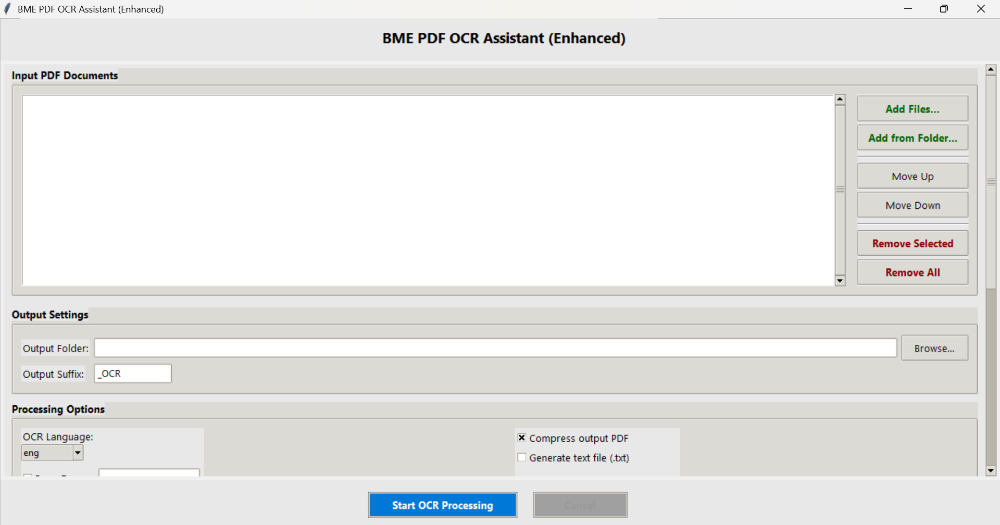

#  BME PDF OCR Assistant

A desktop application designed for Biomedical Engineers (BMEs) and researchers to easily convert image-based or non-searchable PDF documents (like scanned manuals, reports, or legacy files) into fully searchable PDFs using Optical Character Recognition (OCR).


*(Screenshot of the main application window)*

---

## ✨ Features

*   **Accurate OCR:** Uses the Tesseract OCR engine to recognize text within PDF pages.
*   **Searchable PDF Output:** Creates new PDF files with an invisible text layer accurately placed over the original page images, allowing text selection, copying, and searching.
*   **Batch Processing:** Process multiple PDF files in one go.
*   **Intuitive GUI:** User-friendly interface built with Tkinter.
    *   **Drag & Drop:** Add files or folders by dragging them onto the file list.
    *   **File Management:** Add individual files, add all PDFs from a folder, reorder queue, remove selected/all files.
*   **Language Support:** Supports multiple OCR languages, including **English** and **Arabic** (requires installed Tesseract language packs).
*   **Page Range Selection:** Process only specific pages or page ranges (e.g., `1-5, 8, 10-`).
*   **Optional Image Preprocessing:** Includes basic Grayscale and Binarization (Thresholding) options (requires OpenCV) to potentially improve OCR accuracy on difficult scans.
*   **Optional PDF Compression:** Uses Ghostscript to compress the output PDF, reducing file size.
*   **Optional Text File Output:** Generate a separate `.txt` file containing the extracted text for each PDF.
*   **Caching:** Caches processed images and OCR data to speed up reprocessing of the same files. Option to clear the cache via the GUI.
*   **Status & Logging:** Provides real-time progress updates (overall and per-file/page) and logs detailed information to both the GUI and a file (`pdf_ocr_tool.log`).
*   **Configuration Saving:** Remembers last used directories and selected options between sessions (`pdf_ocr_config.json`).

---

## ⚙️ Prerequisites

### 1. Python
*   Python 3.9 or newer recommended.

### 2. Python Libraries
*   Install required libraries using pip. It's highly recommended to use a virtual environment. See `requirements.txt` for specific versions.
    ```bash
    pip install -r requirements.txt
    ```
    *(You need to create the `requirements.txt` file as described previously)*

### 3. External Tools (Required for Running from Source OR Rebuilding)

These tools provide the core OCR, PDF manipulation, and compression functionalities. They need to be downloaded separately and placed correctly within the project folder **before building the executable** or **if running the Python script directly**.

*   **Tesseract OCR Engine:**
    *   **Download:** Get an installer or binaries from the official Tesseract GitHub ([UB Mannheim fork recommended for Windows installers](https://github.com/UB-Mannheim/tesseract/wiki)).
    *   **Language Data:** Ensure you download and install the necessary language data files (e.g., `eng.traineddata`, `ara.traineddata`) into Tesseract's `tessdata` subfolder.
    *   **Placement:** Copy the *entire* Tesseract installation folder (containing `tesseract.exe` and the `tessdata` subfolder) into the project directory and name it `Tesseract-OCR`.
*   **Ghostscript:**
    *   **Download:** Get Ghostscript from the official website ([https://www.ghostscript.com/releases/gsdnld.html](https://www.ghostscript.com/releases/gsdnld.html)).
    *   **Placement:** Copy the *entire* Ghostscript installation folder (containing the `bin` folder with `gswin64c.exe` or similar, and required DLLs) into the project directory and name it `Ghostscript`.
*   **Poppler:** (Required by `pdf2image` on Windows)
    *   **Download:** Download the latest Windows binaries (often distributed as a zip archive) from a reliable source (like [this blog post often linked by developers](https://blog.alivate.com.au/poppler-windows/) or check the `pdf2image` documentation for current recommendations).
    *   **Placement:** Create a `poppler` folder in your project directory. Extract the contents of the Poppler archive into it, ensuring you have the `bin` subfolder (with `pdftoppm.exe`, `pdfinfo.exe`, etc.) and any necessary library (`lib*.dll`) files. The required structure is usually `poppler/bin/` containing the executables and DLLs.

### 4. TkinterDnD Library Files (Bundling Requirement)
*   The necessary Tcl/Tk `tkdnd` library files for drag-and-drop need to be copied locally for PyInstaller.
*   **Placement:** Copy the platform-specific `tkdnd` library folder (e.g., `win-x64` containing `tkdnd.tcl`, `pkgIndex.tcl`) from your installed `tkinterdnd2` package (`site-packages/tkinterdnd2/tkdnd/`) into the project directory inside a folder named `tkdnd_lib`. The required structure is `tkdnd_lib/` containing the necessary Tcl files/DLLs.

---

## 🛠️ Setup & Installation (Running from Source)

1.  **Clone Repository:**
    ```bash
    git clone https://github.com/<YourUsername>/<YourRepositoryName>.git
    cd <YourRepositoryName>
    ```
2.  **Create Virtual Environment (Recommended):**
    ```bash
    python -m venv venv
    # Activate (Windows):
    .\venv\Scripts\activate
    # Activate (Linux/macOS):
    # source venv/bin/activate
    ```
3.  **Install Dependencies:**
    ```bash
    pip install -r requirements.txt
    ```
4.  **Place External Tools & TkDnD:**
    *   Ensure the complete `Tesseract-OCR`, `Ghostscript`, `poppler`, and `tkdnd_lib` folders (as described in Prerequisites) are placed directly inside the project folder.
5.  **Run the Application:**
    ```bash
    python pdf_ocr_2.py
    ```

---

## 🏗️ Building the Executable (.exe)

This project uses PyInstaller to create a standalone Windows executable.

1.  **Ensure Prerequisites:** Make sure Python, pip, and all external tools (`Tesseract-OCR`, `Ghostscript`, `poppler`, `tkdnd_lib`) are correctly placed within the project folder structure.
2.  **Install PyInstaller:** If not already installed in your environment:
    ```bash
    pip install pyinstaller
    ```
3.  **Build:** Navigate to the project folder in your terminal and run PyInstaller using the provided `.spec` file:
    ```bash
    pyinstaller BME_PDF_OCR_Assistant.spec
    ```
    *(Ensure the runtime fix for TkDnD is present in `pdf_ocr_2.py` before building).*
4.  **Find Executable:** The standalone application will be located in the `dist/BME_PDF_OCR_Assistant` folder. You can zip this entire folder for distribution.

---

## 🚀 Usage

1.  **Launch:** Run `BME_PDF_OCR_Assistant.exe` (if built) or `python pdf_ocr_2.py`.
2.  **Add PDFs:**
    *   Click "Add Files..." to browse for individual PDF files.
    *   Click "Add from Folder..." to select a folder and add all PDFs within it.
    *   Drag and drop PDF files or folders containing PDFs onto the file list area.
3.  **Manage Queue:** Select files in the list and use "Move Up", "Move Down", "Remove Selected", or "Remove All".
4.  **Output Settings:**
    *   Click "Browse..." to choose the folder where output files will be saved.
    *   Modify the "Output Suffix" (default: `_OCR`) appended to processed filenames if desired.
5.  **Processing Options:**
    *   Select the primary **OCR Language** (e.g., `eng`, `ara`, `eng+ara`).
    *   Optionally enable and specify a **Page Range** to process only certain pages.
    *   Optionally enable **Image Preprocessing** (Grayscale, Binarize) if scans are unclear (requires OpenCV).
    *   Choose whether to **Compress** the output PDF (requires Ghostscript).
    *   Choose whether to generate plain **Text files**.
    *   Choose whether to **Open output folder** automatically when processing finishes.
6.  **Start Processing:** Click "Start OCR Processing".
7.  **Monitor:** Observe the overall and current file progress bars and status messages. Check the log display area for detailed information.
8.  **Cancel:** Click "Cancel" during processing to stop the batch after the current file finishes its *current step* (like OCRing a page).
9.  **Cache:** Use "Clear Processing Cache" to remove stored intermediate files (requires re-processing if the same PDFs are added again).

---

## ⚙️ Configuration

The application automatically saves your last used directories and selected options in a `pdf_ocr_config.json` file located in the application's directory. You can manually edit this file if needed, but usually settings are managed through the GUI.

---

## ⚠️ Troubleshooting

*   **`Unable to load tkdnd library` Error:** Ensure the `tkdnd_lib` folder was copied correctly into the project directory *before* building and that the runtime fix code is present in the Python script. Verify the path in the `.spec` file's `datas` section matches the runtime fix path.
*   **Tesseract/Ghostscript/Poppler Not Found Errors:** If running from source, ensure the respective folders are correctly placed in the project directory or that the tools are installed and available in your system's PATH environment variable. If running the `.exe`, ensure these folders were correctly bundled by checking the `dist/BME_PDF_OCR_Assistant` folder.
*   **OCR Accuracy Issues:** Try enabling Grayscale/Binarization options. Ensure the correct language pack is selected and installed for Tesseract. Check the source PDF scan quality.
*   **Antivirus Flags:** Standalone executables created by PyInstaller can sometimes trigger false positives from antivirus software. You may need to add an exception for the application.
*   **Check Logs:** For detailed error information, consult the `pdf_ocr_tool.log` file created in the application's directory.